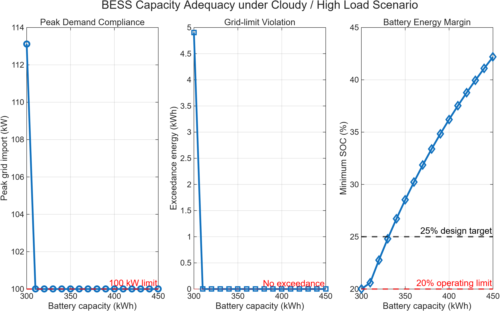
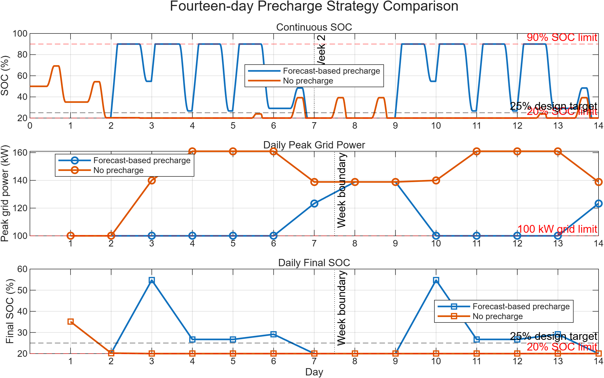
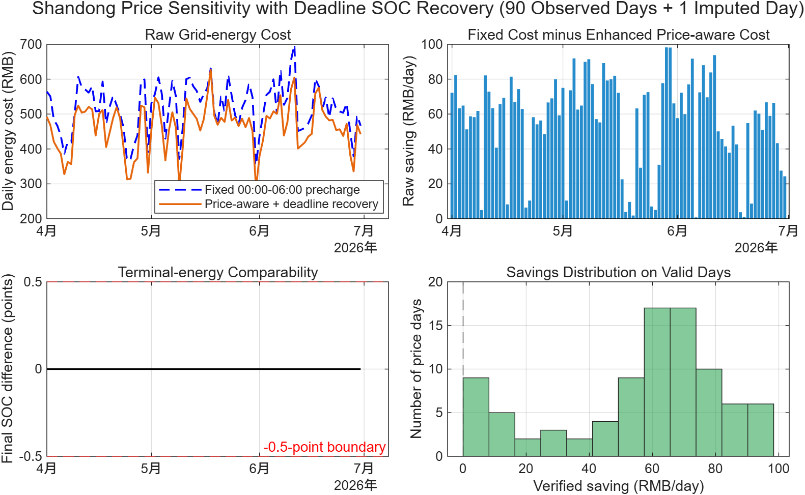

# Grid-connected PV-BESS Energy Management System

A rule-based supervisory energy management system (EMS) for a grid-connected photovoltaic (PV) and battery energy storage system (BESS), built in MATLAB/Simulink. The project takes one engineering requirement, **keep grid import at or below 100 kW without running the battery flat**, and carries it through constraint definition, controller design, worst-case BESS sizing, multi-day validation, fault testing and a price-aware charging study.

**Author:** Chen Jin, BEng Electrical Engineering, The Hong Kong Polytechnic University
**Period:** July–August 2026 (developed during an internship with China Resources Power Investment, Shandong Company)
**Full report:** [`report/Energy_Management_Strategy_for_a_Grid_connected_PV_BESS_System.pdf`](report/Energy_Management_Strategy_for_a_Grid_connected_PV_BESS_System.pdf)

## Key results

| Result | Value |
|---|---:|
| Peak grid import (nominal day) | 140 kW → 100 kW |
| Selected BESS design (worst-case sweep) | 340 kWh / 70 kW |
| 14-day continuous operation, state-aware strategy | 14 / 14 compliant days, 0 kWh exceedance |
| Minimum SOC over 14 days | 26.1% (limit 20%) |
| Engineering validation suite | 5 / 5 scenarios match expected behaviour |
| Price-aware charging, 90 Shandong day-ahead price days | **10.8% lower modeled grid-import energy cost** (mean 56 RMB/day, positive on 90 / 90 days) |



## System model

```text
P_net  = P_load - P_PV
P_grid = P_net  - P_batt
```

- `P_batt > 0`: battery discharging, `P_batt < 0`: battery charging
- `P_grid > 0`: grid import, `P_grid < 0`: grid export
- 15-minute (900 s) supervisory time step

| Parameter | Value |
|---|---:|
| Battery energy capacity | 340 kWh |
| Battery power rating | 70 kW |
| SOC operating range | 20%–90% |
| Charge / discharge efficiency | 95% / 95% |
| Grid-import limit | 100 kW |

## EMS strategy

1. Charge the battery from surplus PV while SOC is below 90%.
2. Discharge when net demand would push grid import above 100 kW.
3. Saturate every command by SOC, energy, power-rating and grid-headroom limits.
4. Precharge from available grid headroom (00:00–06:00) when an adverse day is forecast **or** the inherited SOC is ≤ 40% (state-aware precharging).
5. In price-aware mode, prefer charging below the daily P25 day-ahead price, with a 13:00–17:00 deadline recovery so the battery still reaches the required pre-peak SOC.

Reliability is always checked before an economic action is accepted, so a cheaper result cannot come from ending the day with less stored energy.

## Development story

| Stage | Finding | Response |
|---|---|---|
| 200 kWh / 50 kW prototype | Met the 100 kW limit on a nominal day but failed cloudy / high-load days | Treated nominal success as insufficient; ran adverse scenarios |
| Worst-case capacity sweep (300–450 kWh at 70 kW) | 300 kWh failed (113 kW peak); 310 kWh was feasible with no margin | Selected 340 kWh / 70 kW, the first design with ≥ 5 points of SOC margin |
| 14-day sequential run | Forecast-only precharging failed on days that started with a depleted battery (10 / 14) | Added state-aware precharging → 14 / 14 |
| Price-aware extension | Charging on price alone could lower the terminal SOC | Added deadline SOC recovery and a terminal-energy comparability gate |



## Engineering validation

| Test | Expected | Result |
|---|---|---|
| Nominal operation | Compliant | PASS |
| Complete PV outage | Compliant | PASS |
| Sustained load surge | Power-limited failure | PASS |
| Undersized battery | Energy-limited failure | PASS |
| BESS unavailable | Grid follows net load | PASS |

SOC-constraint, power-rating and power-balance checks passed in all five cases. Fault cases are *expected* to exceed the grid limit when the hardware cannot meet it; the test passes when the controller fails predictably without breaking any physical constraint.

## Price-aware charging study

Each of 90 observed Shandong day-ahead economic clearing-price curves (April–June 2026) was applied to the same representative load and PV day.

| Scope | Days | Cost reduction | Mean saving | Median saving |
|---|---:|---:|---:|---:|
| Observed price days | 90 | 10.805% | 56.05 RMB/day | 62.75 RMB/day |
| Including one imputed day | 91 | 10.797% | 55.94 RMB/day | 62.58 RMB/day |



> **Claim boundary.** This is a controlled sensitivity study using one repeated representative load/PV day. It counts grid-import energy cost only, assumes zero export compensation, and excludes demand charges, CAPEX and degradation. It is not a historical site saving, ROI or payback estimate.

## Repository structure

```text
├── data/      Load, PV and processed day-ahead price profiles (.mat)
├── model/     Simulink models: base EMS, price-aware EMS, P25-only variant, validated backup
├── scripts/   Profile generation, simulation studies and analysis scripts
├── results/   Figures, CSV tables and saved results
└── report/    Technical report (PDF/DOCX), validation checklist, parameter table
```

## Quick start

Requires MATLAB and Simulink.

```matlab
% from the repository root
addpath('scripts');
open_system('model/PV_BESS_EMS.slx');
run_model_validation_suite      % expects: OVERALL RESULT: PASS
```

Other studies: `run_worst_case_capacity_sweep`, `run_14day_state_aware_comparison`, `run_price_aware_single_day_comparison`, `run_91day_price_sensitivity`.

`scripts/prepare_day_ahead_price_data.m` rebuilds `data/day_ahead_price_data.mat` from the original public-market price spreadsheet, which is not included; edit the input path at the top of the script if you have the source file.

## Limitations

- Supervisory energy dispatch only: no converter switching, DC-link, reactive power or electromagnetic transients.
- Load and PV inputs are representative profiles, not synchronized site measurements.
- Fixed 95% efficiencies; no thermal model, ageing or degradation.
- The 340 kWh / 70 kW recommendation applies to the tested profiles and must be mapped to supplier ratings before deployment.
